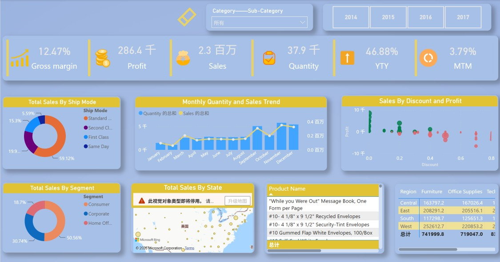

# Superstore 销售经营分析看板

基于 Superstore 订单数据构建的销售经营分析项目，使用 SQL 完成数据质量检查、销售与利润趋势分析、区域与品类分析、产品排名、折扣诊断等，并通过 Power BI 制作交互式看板呈现业务洞察。

## 📁 项目文件说明
- `Superstore_Orders_Data.CSV`：原始订单行级数据集。
- `Superstore_Sales_Analysis.sql`：包含数据清洗、多维度聚合、窗口函数（LAG/RANK）等核心分析代码。
- `Superstore_Sales_Data_Analysis_xkx.pbix`：Power BI 本地看板源文件。
- `dashboard-overview.png`：看板截图预览。

## 📊 看板预览

## 💡 核心业务指标
- **整体表现**：销售额约 2.3 百万，利润约 286.4 千，整体毛利率约 12.47%。
- **增长趋势**：销售额同比（YTY）增长 46.88%，月度环比（MTM）增长 3.79%。
- **配送模式**：Standard Class 销售占比最高（约 59.12%）。
- **客户细分**：Consumer 占比约 50.56%，Corporate 约 30.74%，Home Office 约 18.7%。
- **风险提示**：通过散点图发现，高折扣区间存在明显的利润亏损风险。

## 🔍 SQL 分析模块
`Superstore_Sales_Analysis.sql` 脚本涵盖了以下高级分析：
- **基础汇总**：按品类、区域、配送模式、客户细分统计销售、销量与利润。
- **时间趋势**：年度与月度销售表现，使用 `LAG()` 窗口函数计算月度环比增长率。
- **产品表现**：Top/Bottom 10 产品销售额与利润排名。
- **区域排名**：使用 `RANK() OVER(PARTITION BY Region)` 找出各区域销售额/利润最高的产品。
- **亏损诊断**：筛选负利润产品，分析折扣与利润的关联度。
- **客户行为**：统计单次购买客户。

## 🛠️ 工具与技术
- **SQL** (SQL Server/MySQL)：数据清洗、聚合、CTE、窗口函数。
- **Power BI**：数据建模、DAX指标计算、可视化图表设计。

---
*Note: 项目看板为本地 .pbix 文件，可下载后本地查看。*
